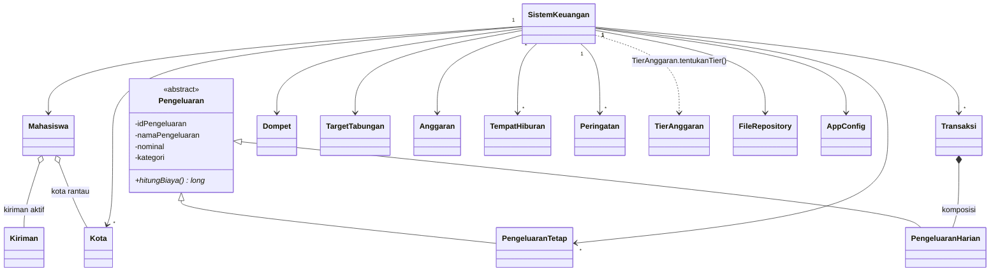

# Sistem Manajemen Keuangan dan Uang Saku Mahasiswa Rantau

Aplikasi desktop Java Swing untuk membantu mahasiswa rantau mengatur uang kiriman sampai kiriman berikutnya.
Proyek mata kuliah Advanced Programming (OOP).

Tanpa database, tanpa server, tanpa API eksternal. Semua data disimpan sebagai file CSV di folder `data/`.

## Cara menjalankan

Kebutuhan: **JDK 17 atau lebih baru**. Tidak perlu Maven/Gradle atau library tambahan.

Skrip mencari JDK di `JAVA_HOME` terlebih dahulu, lalu di JDK bawaan extension VS Code
(`%USERPROFILE%\.vscode\extensions\oracleJdk-25`). Jika JDK Anda ada di tempat lain, set `JAVA_HOME`.

| Tujuan | Windows | Git Bash / Linux / macOS |
|---|---|---|
| Kompilasi saja | `build.bat` | `./build.sh` |
| Jalankan aplikasi | `run.bat` | `./run.sh` |
| Jalankan tes otomatis | `test.bat` | `./test.sh` |

Jalankan dari folder proyek (skrip akan pindah ke folder itu sendiri). Hasil kompilasi masuk ke `out/`.
Saat pertama kali dibuka, isi `data/seed/` disalin ke `data/` dan `data/config.properties` dibuat dengan nilai default.

Manual tanpa skrip:

```
javac --release 17 -encoding UTF-8 -sourcepath src/main/java -d out/main src/main/java/Main.java
java -cp out/main Main
```

Untuk kembali ke data awal, tutup aplikasi lalu hapus `data/*.csv` dan `data/config.properties` (folder `data/seed/` jangan dihapus).

## Halaman aplikasi

| Halaman | Isi |
|---|---|
| Dashboard | Saldo, dana tersedia, sisa anggaran, budget harian/makan/hiburan, grafik pengeluaran per kategori, 5 peringatan terbaru, banner saran hemat saat anggaran menipis. |
| Uang Kiriman | Catat kiriman baru (menambah saldo, memulai periode baru) atau koreksi kiriman aktif. Riwayat semua kiriman. |
| Pengeluaran Tetap | Tambah/ubah/hapus biaya rutin. Opsi "kos ditanggung orang tua". |
| Target Tabungan | Atur target dengan batas maksimal yang ditampilkan beserta rumusnya. |
| Anggaran | Rincian perhitungan langkah demi langkah, tabel tier yang sudah dikali faktor kota, saran hemat. |
| Transaksi Harian | Catat dan hapus pengeluaran harian. Konfirmasi bila melebihi sisa anggaran. |
| Rekomendasi Hiburan | Tempat di kota rantau yang terjangkau sisa budget hiburan; kelola data tempat. |
| Riwayat Peringatan | Semua peringatan beserta jumlah per jenis. |
| Pengaturan | Profil dan kota rantau, persentase makan/hiburan, batas tier, ambang peringatan, data kota dan faktor. |

## Arsitektur

Aplikasi dibagi menjadi lima package dengan arah ketergantungan satu arah:

```
view  ──►  service  ──►  model
              │
              ├──►  repository  ──►  model
              └──►  util (dipakai semua layer)
```

| Package | Tanggung jawab |
|---|---|
| `model` | Entitas dan aturan validasinya (Mahasiswa, Dompet, Pengeluaran, dst.). Tidak tahu soal file atau GUI. |
| `service` | `SistemKeuangan`: koordinator. Menyimpan daftar data, menghitung ulang anggaran setiap ada perubahan, menerapkan faktor kota, rekomendasi hiburan, dan peringatan. |
| `repository` | `FileRepository`: baca/tulis CSV di folder `data/`. Menyalin seed dari `data/seed/` saat file belum ada. |
| `view` | Panel Swing. Hanya menampilkan data dan meneruskan input ke service. Tidak ada rumus keuangan di sini. |
| `util` | `RupiahFormatter`, `DateHelper`, `AppConfig`, `Validasi`. |

## Relasi antarkelas



## Keputusan Desain

1. **Satu sumber kebenaran untuk saldo** (mencegah pengurangan ganda).
   - Kiriman → `Dompet.tambahSaldo()`.
   - Transaksi harian → `Dompet.kurangiSaldo()`. Hapus transaksi → saldo dikembalikan.
   - Pengeluaran tetap **tidak** mengubah saldo; nilainya hanya dicadangkan dalam perhitungan anggaran.
   - Sisa anggaran = Dana Tersedia − total transaksi pada periode aktif. Selalu dihitung ulang, tidak disimpan.
   - Akibatnya, saldo dompet = uang yang benar-benar ada (termasuk dana yang dicadangkan untuk pengeluaran tetap dan tabungan), sedangkan sisa anggaran = uang yang masih boleh dipakai untuk kebutuhan harian.
2. **Periode anggaran** dimulai tanggal kiriman diterima dan berakhir sebelum tanggal kiriman berikutnya. Default tanggal berikutnya = tanggal terima + 1 bulan. Jumlah hari minimal 1.
3. **Kelas tambahan**: `Kiriman` (riwayat kiriman) dan `Kota` (penyesuaian antarkota). `Mahasiswa` menyimpan kiriman aktif dan kota rantau. `Validasi` (util) menampung validasi teks/nominal yang dipakai banyak model agar tidak duplikat.
4. **Transaksi** menyimpan id, tanggal, dan sebuah `PengeluaranHarian` (komposisi). `tambahTransaksi()` dan `hapusTransaksi()` ada di `SistemKeuangan` karena operasi itu mengelola daftar, bukan satu objek.
5. **Polymorphism**: `Pengeluaran.hitungBiaya()` abstract. `PengeluaranTetap` mengembalikan 0 jika kategorinya Kos dan kos ditanggung orang tua; `PengeluaranHarian` mengembalikan nominal. Total dihitung lewat `List<? extends Pengeluaran>` yang memanggil `hitungBiaya()`.
6. **Pos anggaran**: kategori Hiburan → Budget Hiburan. Makan, Jajan, Transportasi, Lainnya → Budget Makan/Kebutuhan.
7. **Konfigurasi** di `data/config.properties` (dibuat otomatis dengan nilai default): persentase makan 0,70 dan hiburan 0,30 (jumlah ≤ 1,0), batas tier Malang, ambang sisa menipis 20%, ambang pengeluaran tetap 60% dari kiriman. Bisa diubah dari halaman Pengaturan.
8. **Target tabungan**: 0 ≤ target ≤ kiriman − total pengeluaran tetap. Jika lebih, input ditolak dan peringatan dibuat. Dana Tersedia tidak pernah negatif.
9. **Peringatan** dengan jenis dan tanggal yang sama tidak dibuat dua kali.
10. **Penyimpanan**: satu CSV per entitas di `data/`, ada header, delimiter `;`. Teks yang mengandung `;` ditolak. Tanggal di file memakai format ISO (`yyyy-MM-dd`) agar tidak ambigu; tampilan memakai format Indonesia. Baris rusak dilewati dan dicatat ke stderr.
11. **Rekomendasi hiburan**: tempat di kota mahasiswa dengan `biayaMinimum ≤ sisa budget hiburan`, urut dari termurah.
12. **Nominal** memakai `long` (Rupiah tanpa desimal). Faktor/persentase memakai `double`, hasil kali dibulatkan dengan `Math.round`.

## Kota adaptif

Malang (Kota) adalah acuan dengan faktor 1,00. Data di `data/kota.csv`: `namaKota;umk;persenKenaikanHarga`.

- Jika `persenKenaikanHarga` diisi: `faktor = 1 + persen/100` (contoh: Surabaya diisi 10 → 1,10).
- Jika kosong: `faktor = umkKota / umkMalang` (contoh: 5.288.796 / 3.736.101 ≈ 1,416).
- Batas tier efektif = batas tier Malang × faktor. Persentase makan/hiburan tidak diskalakan.

**Catatan penting:** selisih UMK hanya pendekatan kasar untuk selisih harga. Upah minimum Surabaya 41,6% lebih tinggi dari Malang, tetapi harga makan dan kos belum tentu setinggi itu. Isi `persenKenaikanHarga` berdasarkan pengalaman nyata di kota tersebut.

UMK 2026 resmi yang dipakai sebagai seed: Kota Malang Rp3.736.101, Kabupaten Malang Rp3.802.862, Batu Rp3.562.484, Surabaya Rp5.288.796, Semarang Rp3.701.709, Kota Yogyakarta Rp2.827.593.

## Potensi kesalahan logika dan penanganannya

| Risiko | Penanganan |
|---|---|
| Saldo terpotong dua kali (oleh transaksi dan oleh perhitungan anggaran) | Lihat Keputusan Desain 1: anggaran tidak pernah mengubah saldo. |
| Dana tersedia negatif ketika pengeluaran tetap + target > kiriman | Dana tersedia di-clamp ke 0; target yang terlalu besar ditolak; peringatan dibuat. |
| Pembagian dengan nol untuk budget harian | Jumlah hari periode minimal 1. |
| Persentase makan + hiburan > 100% | Ditolak oleh `AppConfig`. |
| Biaya kos ikut terhitung padahal ditanggung orang tua | `PengeluaranTetap.hitungBiaya()` mengembalikan 0. |
| Transaksi di luar periode memengaruhi sisa anggaran | Hanya transaksi dalam periode aktif yang dihitung. |
| Mengubah nominal kiriman membuat saldo tidak konsisten | Saldo disesuaikan sebesar selisihnya saja. |
| Peringatan berulang setiap kali data berubah | Satu peringatan per jenis per tanggal. |
| File CSV rusak membuat aplikasi crash | Baris rusak dilewati, dicatat ke stderr. |
| Kota acuan dihapus sehingga faktor tidak bisa dihitung | Kota acuan tidak bisa dihapus. |

## Data dummy

Saat pertama kali dijalankan, isi `data/seed/` disalin ke `data/`. Semua seed adalah **data dummy – pengalaman pribadi**, bukan hasil survei:
profil mahasiswa, kiriman Rp2.000.000 (01/11/2026–01/12/2026), pengeluaran tetap (kos, kuota, bensin, servis), target tabungan Rp200.000, contoh transaksi, dan contoh tempat hiburan dengan biaya estimasi.

## Empat pilar OOP di kode

| Pilar | Di mana | Penjelasan singkat |
|---|---|---|
| **Encapsulation** | `model/Pengeluaran.java:12-16`, `model/Dompet.java:13-31` | Atribut `private`; perubahan hanya lewat method yang memvalidasi. Saldo tidak bisa di-set langsung, hanya `tambahSaldo()`/`kurangiSaldo()`, dan `kurangiSaldo()` menolak saldo negatif. Daftar data di `service/SistemKeuangan.java:51-57` juga `private`; panel hanya menerima salinan baca. |
| **Inheritance** | `model/PengeluaranTetap.java:9`, `model/PengeluaranHarian.java:6` | Keduanya `extends Pengeluaran` dan memakai ulang id, nama, nominal, kategori, serta validasinya. Di GUI, semua halaman `extends BasePanel` (contoh `view/DashboardPanel.java:23`) dan mewarisi header, `jalankan()`, serta dialog. |
| **Polymorphism** | `model/PengeluaranTetap.java:23-29`, `model/PengeluaranHarian.java:17-20`, `service/SistemKeuangan.java:161-167` | `hitungBiaya()` di-override: pengeluaran tetap kategori Kos bernilai 0 bila ditanggung orang tua, pengeluaran harian selalu penuh. `hitungTotalBiaya(List<? extends Pengeluaran>)` memanggil `hitungBiaya()` tanpa tahu jenis aslinya. Di GUI, `DashboardFrame` memanggil `muatUlang()` pada setiap `BasePanel`. |
| **Abstraction** | `model/Pengeluaran.java:10,29,32`, `view/BasePanel.java:55` | `Pengeluaran` adalah kelas abstract dengan method abstract `hitungBiaya()` dan `getJenis()`; tidak bisa dibuat objeknya langsung. `BasePanel.muatUlang()` abstract: setiap halaman wajib menentukan cara menampilkan datanya. GUI hanya memanggil method `SistemKeuangan` tanpa tahu cara data disimpan ke CSV. |

Relasi lain: **komposisi** `Transaksi` memiliki satu `PengeluaranHarian` (`model/Transaksi.java:16`); **agregasi** `Mahasiswa` merujuk `Kota` dan `Kiriman` aktif.

## Mengganti data dummy dengan data Anda

Cara termudah: lewat aplikasi. Ubah nama dan kota di **Pengaturan**, catat kiriman di **Uang Kiriman**, isi biaya rutin di **Pengeluaran Tetap**, lalu hapus transaksi contoh di **Transaksi Harian**. Semua perubahan langsung tersimpan.

Atau edit CSV saat aplikasi tertutup (delimiter `;`, baris pertama header, tanggal `yyyy-MM-dd`, nominal tanpa titik):

| File | Kolom |
|---|---|
| `mahasiswa.csv` | `idMahasiswa;namaMahasiswa;statusKosDitanggung;namaKota` |
| `dompet.csv` | `idDompet;saldo` |
| `kiriman.csv` | `idKiriman;nominal;tanggalTerima;tanggalBerikutnya` |
| `pengeluaran_tetap.csv` | `idPengeluaran;namaPengeluaran;kategori;nominal` |
| `tabungan.csv` | `nominalTabungan` |
| `transaksi.csv` | `idTransaksi;tanggal;kategori;keterangan;nominal` (kategori: Makan, Jajan, Transportasi, Hiburan, Lainnya) |
| `tempat_hiburan.csv` | `namaTempat;lokasi;kota;biayaMinimum;biayaMaksimum;tier` (tier: Hemat, Sedang, Lumayan, Nyaman) |
| `kota.csv` | `namaKota;umk;persenKenaikanHarga` |

Bila mengedit file langsung, pastikan `dompet.csv` sesuai (total kiriman − total transaksi), karena saldo disimpan, bukan dihitung ulang dari riwayat.
Untuk mengubah data awal bagi pengguna baru, edit file di `data/seed/` dengan format yang sama.

## Menambah kota baru

Di **Pengaturan → Kota dan faktor biaya hidup**: isi nama kota dan UMK, lalu salah satu:

- isi **Kenaikan harga (%)** sesuai pengalaman (misal 10 → harga 10% lebih mahal dari Malang, faktor 1,10), atau
- kosongkan agar faktor dihitung dari UMK ÷ UMK Malang.

Setelah itu pilih kota tersebut di **Profil** dan tambahkan tempat hiburannya di **Rekomendasi Hiburan**. Batas tier langsung ikut dikali faktor kota.

## Pengujian

### Otomatis (`test.bat` / `test.sh`)

Tes ditulis tanpa JUnit (`src/test/java`) agar tidak butuh library. Tanggal "hari ini" dipatok ke 18 November 2026 lewat `Clock`, dan setiap kasus memakai folder sementara.

- `LogikaAnggaranTest`: rumus dana tersedia, budget harian, 70/30, kos ditanggung (polymorphism), target tabungan melebihi batas, transaksi dan saldo, hapus transaksi mengembalikan saldo, transaksi di luar periode, tier dan faktor kota (Malang, Surabaya persen/UMK), peringatan tidak ganda, validasi input.
- `RepositoryTest`: salin seed, simpan lalu muat ulang (round-trip), baris CSV rusak dilewati, `config.properties` rusak kembali ke default.

Hasil terakhir: **24 kasus, 165 assertion lulus, 0 gagal**.

### Pemeriksaan GUI yang sudah dilakukan

- Kesembilan halaman dibuka lewat tombol sidebar dari data seed baru, tanpa exception, dan tampilannya diperiksa.
- Aksi tambah transaksi lewat form: baris baru masuk `transaksi.csv` dan saldo berkurang sesuai nominal.
- `run.bat` dari salinan bersih: kompilasi, salin seed, dan jendela terbuka tanpa error.

### Checklist manual yang disarankan sebelum demo

- [ ] Tambah transaksi melebihi sisa anggaran: muncul konfirmasi; jika dibatalkan, tidak tercatat.
- [ ] Hapus transaksi: saldo kembali.
- [ ] Centang "kos ditanggung orang tua": dana tersedia naik sebesar biaya kos.
- [ ] Target tabungan di atas batas: ditolak dengan pesan.
- [ ] Ganti kota ke Surabaya: faktor dan batas tier berubah, rekomendasi hiburan mengikuti kota.
- [ ] Input salah (huruf di nominal, tanggal 31/02/2026): muncul pesan, isian tidak terhapus.
- [ ] Tutup lalu buka lagi aplikasi: semua data masih ada.
