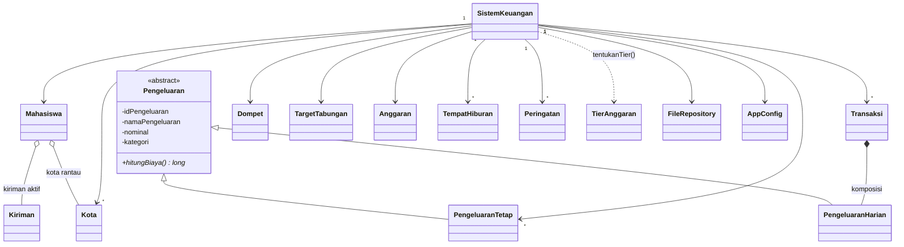

# Sistem Manajemen Keuangan dan Uang Saku Mahasiswa Rantau

Aplikasi desktop Java Swing untuk membantu mahasiswa rantau mengatur uang kiriman sampai kiriman berikutnya.
Proyek mata kuliah Advanced Programming (OOP).

> Status dokumen: rancangan (Tahap 1). Bagian cara menjalankan dan penjelasan OOP dilengkapi di Tahap 7.

## Arsitektur

Aplikasi dibagi menjadi lima package dengan arah ketergantungan satu arah:

```
view  ──►  service  ──►  model
              │
              ├──►  repository  ──►  model
              └──►  util (dipakai semua layer)
```

| Package | Tanggung jawab |
|---|---|
| `model` | Entitas dan aturan validasinya (Mahasiswa, Dompet, Pengeluaran, dst.). Tidak tahu soal file atau GUI. |
| `service` | `SistemKeuangan`: koordinator. Menyimpan daftar data, menghitung ulang anggaran setiap ada perubahan, menerapkan faktor kota, rekomendasi hiburan, dan peringatan. |
| `repository` | `FileRepository`: baca/tulis CSV di folder `data/`. Menyalin seed dari `data/seed/` saat file belum ada. |
| `view` | Panel Swing. Hanya menampilkan data dan meneruskan input ke service. Tidak ada rumus keuangan di sini. |
| `util` | `RupiahFormatter`, `DateHelper`, `AppConfig`, `Validasi`. |

## Relasi antarkelas



## Keputusan Desain

1. **Satu sumber kebenaran untuk saldo** (mencegah pengurangan ganda).
   - Kiriman → `Dompet.tambahSaldo()`.
   - Transaksi harian → `Dompet.kurangiSaldo()`. Hapus transaksi → saldo dikembalikan.
   - Pengeluaran tetap **tidak** mengubah saldo; nilainya hanya dicadangkan dalam perhitungan anggaran.
   - Sisa anggaran = Dana Tersedia − total transaksi pada periode aktif. Selalu dihitung ulang, tidak disimpan.
   - Akibatnya, saldo dompet = uang yang benar-benar ada (termasuk dana yang dicadangkan untuk pengeluaran tetap dan tabungan), sedangkan sisa anggaran = uang yang masih boleh dipakai untuk kebutuhan harian.
2. **Periode anggaran** dimulai tanggal kiriman diterima dan berakhir sebelum tanggal kiriman berikutnya. Default tanggal berikutnya = tanggal terima + 1 bulan. Jumlah hari minimal 1.
3. **Kelas tambahan**: `Kiriman` (riwayat kiriman) dan `Kota` (penyesuaian antarkota). `Mahasiswa` menyimpan kiriman aktif dan kota rantau. `Validasi` (util) menampung validasi teks/nominal yang dipakai banyak model agar tidak duplikat.
4. **Transaksi** menyimpan id, tanggal, dan sebuah `PengeluaranHarian` (komposisi). `tambahTransaksi()` dan `hapusTransaksi()` ada di `SistemKeuangan` karena operasi itu mengelola daftar, bukan satu objek.
5. **Polymorphism**: `Pengeluaran.hitungBiaya()` abstract. `PengeluaranTetap` mengembalikan 0 jika kategorinya Kos dan kos ditanggung orang tua; `PengeluaranHarian` mengembalikan nominal. Total dihitung lewat `List<? extends Pengeluaran>` yang memanggil `hitungBiaya()`.
6. **Pos anggaran**: kategori Hiburan → Budget Hiburan. Makan, Jajan, Transportasi, Lainnya → Budget Makan/Kebutuhan.
7. **Konfigurasi** di `data/config.properties` (dibuat otomatis dengan nilai default): persentase makan 0,70 dan hiburan 0,30 (jumlah ≤ 1,0), batas tier Malang, ambang sisa menipis 20%, ambang pengeluaran tetap 60% dari kiriman. Bisa diubah dari halaman Pengaturan.
8. **Target tabungan**: 0 ≤ target ≤ kiriman − total pengeluaran tetap. Jika lebih, input ditolak dan peringatan dibuat. Dana Tersedia tidak pernah negatif.
9. **Peringatan** dengan jenis dan tanggal yang sama tidak dibuat dua kali.
10. **Penyimpanan**: satu CSV per entitas di `data/`, ada header, delimiter `;`. Teks yang mengandung `;` ditolak. Tanggal di file memakai format ISO (`yyyy-MM-dd`) agar tidak ambigu; tampilan memakai format Indonesia. Baris rusak dilewati dan dicatat ke stderr.
11. **Rekomendasi hiburan**: tempat di kota mahasiswa dengan `biayaMinimum ≤ sisa budget hiburan`, urut dari termurah.
12. **Nominal** memakai `long` (Rupiah tanpa desimal). Faktor/persentase memakai `double`, hasil kali dibulatkan dengan `Math.round`.

## Kota adaptif

Malang (Kota) adalah acuan dengan faktor 1,00. Data di `data/kota.csv`: `namaKota;umk;persenKenaikanHarga`.

- Jika `persenKenaikanHarga` diisi: `faktor = 1 + persen/100` (contoh: Surabaya diisi 10 → 1,10).
- Jika kosong: `faktor = umkKota / umkMalang` (contoh: 5.288.796 / 3.736.101 ≈ 1,416).
- Batas tier efektif = batas tier Malang × faktor. Persentase makan/hiburan tidak diskalakan.

**Catatan penting:** selisih UMK hanya pendekatan kasar untuk selisih harga. Upah minimum Surabaya 41,6% lebih tinggi dari Malang, tetapi harga makan dan kos belum tentu setinggi itu. Isi `persenKenaikanHarga` berdasarkan pengalaman nyata di kota tersebut.

UMK 2026 resmi yang dipakai sebagai seed: Kota Malang Rp3.736.101, Kabupaten Malang Rp3.802.862, Batu Rp3.562.484, Surabaya Rp5.288.796, Semarang Rp3.701.709, Kota Yogyakarta Rp2.827.593.

## Potensi kesalahan logika dan penanganannya

| Risiko | Penanganan |
|---|---|
| Saldo terpotong dua kali (oleh transaksi dan oleh perhitungan anggaran) | Lihat Keputusan Desain 1: anggaran tidak pernah mengubah saldo. |
| Dana tersedia negatif ketika pengeluaran tetap + target > kiriman | Dana tersedia di-clamp ke 0; target yang terlalu besar ditolak; peringatan dibuat. |
| Pembagian dengan nol untuk budget harian | Jumlah hari periode minimal 1. |
| Persentase makan + hiburan > 100% | Ditolak oleh `AppConfig`. |
| Biaya kos ikut terhitung padahal ditanggung orang tua | `PengeluaranTetap.hitungBiaya()` mengembalikan 0. |
| Transaksi di luar periode memengaruhi sisa anggaran | Hanya transaksi dalam periode aktif yang dihitung. |
| Mengubah nominal kiriman membuat saldo tidak konsisten | Saldo disesuaikan sebesar selisihnya saja. |
| Peringatan berulang setiap kali data berubah | Satu peringatan per jenis per tanggal. |
| File CSV rusak membuat aplikasi crash | Baris rusak dilewati, dicatat ke stderr. |
| Kota acuan dihapus sehingga faktor tidak bisa dihitung | Kota acuan tidak bisa dihapus. |

## Data dummy

Saat pertama kali dijalankan, isi `data/seed/` disalin ke `data/`. Semua seed adalah **data dummy – pengalaman pribadi**, bukan hasil survei:
profil mahasiswa, kiriman Rp2.000.000 (01/11/2026–01/12/2026), pengeluaran tetap (kos, kuota, bensin, servis), target tabungan Rp200.000, contoh transaksi, dan contoh tempat hiburan dengan biaya estimasi.
